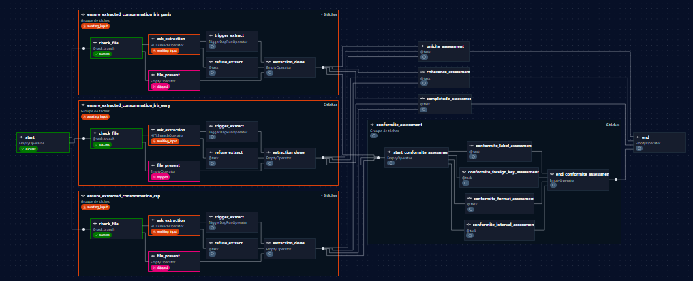
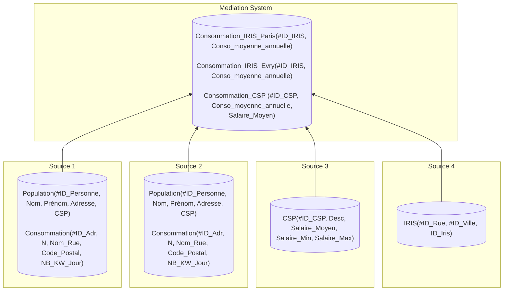
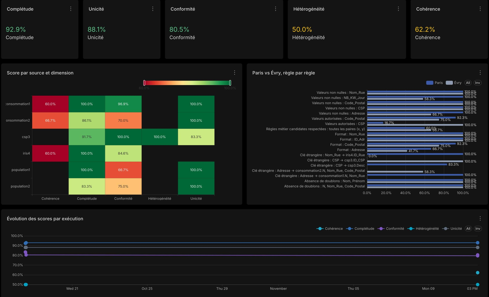

# Projet de Qualité de données : ETL-DQ

## Choix de l'ETL

**ETL** choisit : _Airflow_.



## MS - Schéma cible

### Schéma



### Mapping

#### Consommation_IRIS_Paris

$R_1 = Source1.Consommation \Join_{\verb|C.Nom_Rue| = \verb|I.ID_Rue| \land \verb|map_as_city(C.Code_Postal)| = \verb|I.ID_Ville|} Source4.IRIS$

$\verb|Consommation_IRIS_Paris| = \rho_{\verb|ID_Iris| \to \verb|ID_IRIS|} \big(\gamma_{\verb|ID_Iris| ; AVG(\verb|NB_KW_Jour| \times 365) \to \verb|Conso_moyenne_annuelle|}(R_1)\big)$

#### Consommation_IRIS_Evry

$R_2 = Source2.Consommation \Join_{\verb|I.ID_Rue| \preceq \verb|C.Nom_Rue|  \land \verb|C.Code_Postal| = \verb|I.ID_Ville|} Source4.IRIS$

$\verb|Consommation_IRIS_Evry| = \rho_{\verb|ID_Iris| \to \verb|ID_IRIS|} \big(\gamma_{\verb|ID_Iris| ; AVG(\verb|NB_KW_Jour| \times 365) \to \verb|Conso_moyenne_annuelle|}(R_2)\big)$

#### Consommation_CSP

$R_{3,1} = \big(Source1.Population \Join_{\verb|extract_adr(P1.Adresse, {N, Nom_Rue})| = (\verb|C1.N|, \verb|C1.Nom_Rue|)} Source1.Consommation\big)$
$R_{3,2} = \big(Source2.Population \Join_{\verb|extract_adr(P2.Adresse, {N, Nom_Rue, Code_Postal})| = (\verb|C2.N|, \verb|C2.Nom_Rue|, \verb|C2.Code_Postal|)} Source2.Consommation\big)$
$R_{3,3} = \gamma_{\verb|ID_CSP|, \verb|Salaire_Moyen|, \verb|NB_KW_Jour|}\big(R_{3,1} \Join_{R_{3,1}.CSP \preceq \verb|CSP3.Desc| } Source3.CSP\big)$
$R_{3,4} = \gamma_{\verb|CSP| \to \verb|ID_CSP|, \verb|Salaire_Moyen|, \verb|NB_KW_Jour|}\big(R_{3,2} \Join_{R_{3,2}.CSP = \verb|CSP3.ID_CSP| } Source3.CSP\big)$
$\verb|Consommation_CSP| = \gamma_{\verb|ID_CSP|, \verb|Salaire_Moyen|, AVG(\verb|NB_KW_Jour| \times 365) \to \verb|Conso_moyenne_annuelle|}(R_{3,3} \cup R_{3,4})$

> [!NOTE]
> **Changelog**
>
> - **Consommation_IRIS_Paris** : ajout de la conversion des codes postaux parisiens en nom de ville pour la jointure avec les IRIS.
> - **Consommation_IRIS_Evry** : remplacement de la correspondance exacte des rues par une correspondance approximative.
> - **Consommation_CSP** : extraction des composants des adresses et adaptation des jointures CSP selon les sources.

### Requêtes

- **Consommation_IRIS_Paris** (Source1 &#10781; Source4) :

```SQL
INSERT INTO Consommation_IRIS_Paris(ID_IRIS, Conso_moyenne_annuelle)
SELECT 
    i.ID_Iris,
    AVG(c.NB_KW_Jour * 365) AS Conso_moyenne_annuelle
FROM Source1.Consommation c
JOIN Source4.IRIS i
    ON c.Nom_Rue    = i.ID_Rue
   AND (CASE WHEN TRY_CAST(c.Code_Postal AS INTEGER) BETWEEN 75000 AND 75999 THEN 'Paris' ELSE CAST(c.Code_Postal AS VARCHAR) END) = i.ID_Ville
GROUP BY i.ID_Iris;
```

- **Consommation_IRIS_Evry** (Source2 &#10781; Source4) :

```SQL
INSERT INTO Consommation_IRIS_Evry (ID_IRIS, Conso_moyenne_annuelle)
SELECT 
    i.ID_Iris,
    AVG(c.NB_KW_Jour * 365) AS Conso_moyenne_annuelle
FROM Source2.Consommation c
JOIN Source4.IRIS i
    ON CONTAINS(LOWER(c.Nom_Rue), LOWER(TRIM(i.ID_Rue)))
GROUP BY i.ID_Iris;
```

- **Consommation_CSP** (Source1 &#10781; Source2 &#10781; Source3) :

```SQL
-- Pseudo-SQL : extract_adr() extrait et normalise les éléments
-- de l'adresse (numéro, nom de rue, code postal).

INSERT INTO Consommation_CSP (ID_CSP, Conso_moyenne_annuelle, Salaire_Moyen)
WITH
-- Paris : jointure Population / Consommation sur N et Nom_Rue
Paris AS (
    SELECT p.CSP, c.NB_KW_Jour
    FROM Source1.Population p
    JOIN Source1.Consommation c
        ON extract_adr(p.Adresse, 'N') = c.N
       AND extract_adr(p.Adresse, 'Nom_Rue') = c.Nom_Rue
),

-- Evry : jointure sur N, Nom_Rue et Code_Postal
Evry AS (
    SELECT p.CSP, c.NB_KW_Jour
    FROM Source2.Population p
    JOIN Source2.Consommation c
        ON extract_adr(p.Adresse, 'N') = c.N
       AND extract_adr(p.Adresse, 'Nom_Rue') = c.Nom_Rue
       AND extract_adr(p.Adresse, 'Code_Postal') = c.Code_Postal
),

-- Paris : correspondance approximative avec la description CSP
CSP_Paris AS (
    SELECT csp.ID_CSP, csp.Salaire_Moyen, p.NB_KW_Jour
    FROM Paris p
    JOIN Source3.CSP csp
        ON CONTAINS(LOWER(csp.Desc), LOWER(TRIM(p.CSP)))
),

-- Evry : correspondance exacte avec l'identifiant CSP
CSP_Evry AS (
    SELECT csp.ID_CSP, csp.Salaire_Moyen, e.NB_KW_Jour
    FROM Evry e
    JOIN Source3.CSP csp
        ON e.CSP = csp.ID_CSP
),

-- Regroupement des deux sources
Sources_Reunies AS (
    SELECT ID_CSP, Salaire_Moyen, NB_KW_Jour FROM CSP_Paris
    UNION ALL
    SELECT ID_CSP, Salaire_Moyen, NB_KW_Jour FROM CSP_Evry
)

SELECT
    ID_CSP,
    AVG(NB_KW_Jour * 365) AS Conso_moyenne_annuelle,
    Salaire_Moyen
FROM Sources_Reunies
GROUP BY ID_CSP, Salaire_Moyen;
```

## Qualité de données

### Facettes & Métriques :

#### Conformité

La **Conformité** mesure la validité du format des données.

Métriques :

- Format des chaînes de caractères :
  + Concept :\
    Évaluation de REGEX pour vérifier le format des données suivantes :

    - `Source1.Population.Adresse`
    - `Source2.Population.Adresse`
    - `Source1.Consommation.ID_Adr`
    - `Source2.Consommation.ID_Adr`
    - `Source1.Consommation.Nom_Rue`
    - `Source2.Consommation.Nom_Rue`
    - `Source4.IRIS.ID_Rue`

    Exemple : `Source1.Population.Adresse` = '12' est invalide.
  + Formalisme :\
    Soit $R$ la relation tel que $|R| = N$, $C$ l'ensemble des attributs de $R$, tel que $C' \subseteqq C$ et $P$ l'ensemble des formats attendu.\
    On a $\phi_{p}(c, R) = \frac{1}{N} \sum_{t \in R} 1[match(t[c], p)] \in [0, 1]$\
    Tel qu'on obtient les scores au plus petit niveau de granularité (1 ligne / colonne et format) :\
    $\forall p \in P$ on a $\{ \phi_p(c, R) \}_{c \in C' }$
- Ensemble fini de données (labels) :
  + Concept :\
    Évaluation de l'appartenance de l'ensemble des données _X_ à un ensemble prédéfinis de labels _Y_ :

    - `Source1.Population.CSP`
    - `Source2.Population.CSP`
    - `Source3.CSP.ID_CSP`
    - `Source1.Population.Code_Postal`
    - `Source2.Population.Code_Postal`
    - `Source4.IRIS.ID_Ville`

    Exemple :
    `Source3.CSP.ID_CSP` &#8838; {
    "agriculteurs exploitants",
    "artisans, commerçants et chefs d’entreprise",
    "cadres et professions intellectuelles supérieures",
    "professions intermédiaires",
    "employés",
    "ouvriers",
    "retraités",
    "autres personnes sans activité professionnelle",
    }
  + Formalisme :\
    Soit $R$ la relation tel que $|R| = N$, $C$ l'ensemble des attributs de $R$, tel que $C' \subseteqq C$ et $L$ un ensemble de données attendues.\
    On a $\phi_{L}(c, R) = \frac{1}{N} \sum_{t \in R} 1[t[c] \in L] \in [0, 1]$\
    Tel qu'on obtient les scores au plus petit niveau de granularité (1 ligne / colonne et ensemble de données) :\
    $\forall L$ on a $\{ \phi_L(c, R) \}_{c \in C' }$
- Validité d'intervalles de données :
  + Concept :\
    On compare les inégalitées d'une relation ternaire.\
    Tel que &forall; _t_ &#8712; `Source3.CSP` vérifie _t[Salaire\_Min]_ <= _t[Salaire\_Moyen]_ <= _t[Salaire\_Max]_

  + Formalisme:\
    Soit $R$ la relation tel que $|R| = N$, $C$ l'ensemble des attributs de $R$, tel qu'on a $x, y, z \in C^3$ avec $x \neq y \neq z$.\
    $\phi(x, y, z) = 1 - \frac{1}{N} \sum_{t \in R} 1[\neg (t[x] <= t[y] <= t[z])]$

- Validité des formats extra sources :
  + Concept :\
    Vérification de la validité des clés étrangères :

    - set(`Source1.Consommation.Code_Postal`) &#8838; set(`Source4.IRIS.ID_Ville`)
    - set(`Source2.Consommation.Code_Postal`) &#8838; set(`Source4.IRIS.ID_Ville`)
    - set(`Source1.Population.CSP`) &#8838; set(`Source3.ID_CSP`)
    - set(`Source2.Population.CSP`) &#8838; set(`Source3.ID_CSP`)

    Exemple : `Source1.Population.CSP` doit appartenir à l'ensemble des `ID_CSP` définis dans `Source3.CSP`, sinon la donnée serait invalide.
  
  + Formalisme :\
    Soit $R_1$, $R_2$ deux relations tel que $|R_1| = N_1$ et $C_1$ l'ensemble des attributs de $R_1$ (resp. $C_2$ pour $R_2$).\
    \
    Extraction :\
    Soit $Exp(.; C_1, \theta) : R_1 \rightarrow R_1'$ le prétraitrement composé de l'extraction $\theta$ qui à partir de $C_1 \subseteq R_1$ produit les colonnes $K$. Tel que $\theta$ assure $K = C_2$\
    \
    Fuzzy Join :\
    Soit $Fuzzy(R_1, R_2, C_1, C_2) = \{t_1 \in R_1 : \exists t_2 \in R_2, t_2[C_2] \unrhd t_1[C_1] \}$\
    \
    Calcul de la métrique :
    
    $\phi^{fk}(R_1, R_2, C_1, C_2) = \frac{1}{N_1}|\{ t_1 \in R_1 : \exists t_2 \in R_2, t_1[C_1] = t_2[C_2]\}|$
    
    $\phi^{fk}_{exp}(R_1, R_2, C_1, C_2, \theta) = \frac{1}{N_1}|\{ t_1 \in Exp(R_1, C_1, \theta) : \exists t_2 \in R_2, t_1[C_2] = t_2[C_2]\}|$

    $\phi^{fk}_{fuz}(R_1, R_2, C_1, C_2) = \frac{1}{N_1}|Fuzzy(R_1, R_2, C_1, C_2)|$
    
    On a donc :
    
    $\mathcal{C}_{fk} \subseteq C_1 \times C_2$

    $\mathcal{C}_{exp} \subseteq C_1 \times C_2 \times \Theta$

    $\mathcal{C}_{fuz} \subseteq C_1 \times C_2$

    $\Phi_{fk}(R_1, R_2, \mathcal C) = \bigcup\limits_{(C_1,C_2)\in\mathcal C_{fk}} \bigl\lbrace\phi^{fk}(R_1,R_2,C_1,C_2)\bigr\rbrace \cup \bigcup\limits_{(C_1,C_2,\theta)\in\mathcal C_{exp}} \bigl\lbrace\phi_{exp}^{fk}(R_1,R_2,C_1,C_2,\theta)\bigr\rbrace \cup \bigcup\limits_{(C_1,C_2)\in\mathcal C_{fuz}} \bigl\lbrace\phi_{fuz}^{fk}(R_1,R_2,C_1,C_2)\bigr\rbrace$

#### Hétérogénéité des échelles

L'**Hétérogénéité des échelles** mesure la dissimilarité des unités/échelles entre des données modélisant la même chose.

Métriques :

- Différence de dispersion relative - inter-sources :
  + Concept :\
    On mesure l'hétérogénéité des échelles avec un indicateur statistique calculé sur la distribution des données de deux colonnes :
      - _X_ = `Source1.Consommation.NB_KW_Jour` et _Y_ = `Source2.Consommation.NB_KW_Jour`
  + Formalisme :\
    Soit $X$ un ensemble de valeurs numériques tel que $CV(X) = \frac{\sigma_X}{|\mu_X|}$\
    Tel que $d_{CV}(X, Y) = ln(\frac{CV(X)}{CV(Y)})$\
    On attends $d_{CV} <= ln(5)$\
    \
    Soit $R_1$, $R_2$ deux relations tel que $|R_1| = N_1$ et $C_1$ l'ensemble des attributs de $R_1$ (resp. $C_2$ pour $R_2$).\
    Tel que $\phi_{d_{CV}}(R_1, R_2) = \{1[|d_{CV}(\pi_{c_1}(R_1), \pi_{c_2}(R_2)) \leq ln(5)|]\}_{c_1, c_2 \in C'_1 \times C'_2}$

  
- Ratio de position (RP) - intra-source :
  + Concept :\
    On mesure statistiquement si les valeurs de la colonne $y$ sont proches des extremums ($x$, $z$) :
      - _R_ = `Source3.CSP`, (_x_, _y_, _z_) = (`Salaire_Min`, `Salaire_Moyen`, `Salaire_Max`) et $\epsilon = 0.1$
  
  + Formalisme :\
    Soit $R$ une relation tel que $|R| = N$, $C$ les attributs de $R$ tel que $x, y, z \in C^3$ avec $x \neq y \neq z$.\
    On suppose que $\forall t \in R, t[x] \leq t[y] \leq t[z]$.\
    On a $RP(R, x, y, z, \epsilon) = \frac{1}{N} \sum_{\forall t \in R}1 [\frac{(t[y] − t[x])}{(t[z] − t[x])} \notin [\epsilon, 1-\epsilon]]$\
    On définit $C_x, C_y, C_z \subseteq C$ et $\epsilon \in [0; 1]$.\
    Tel que $\phi_{RP}(R) = \{1-RP(R, x, y, z, \epsilon)\}_{x,y,z \in C_x \times C_y \times C_z}$

#### Complétude des données

La **Complétude** mesure la quantité de données manquantes d'une base de données.

Métriques :

- Mesure du pourcentage de valeurs manquantes :
  + Concept :
    - `Source4.IRIS.ID_Iris`
    - `Source1.Consommation.NB_KW_Jour`
    - `Source2.Consommation.NB_KW_Jour`
    - `Source1.Population.CSP`
    - `Source2.Population.CSP`
    - `Source3.CSP.Salaire_Moyen`
    - `Source3.CSP.ID_CSP`
    - `Source1.Population.Adresse`
    - `Source2.Population.Adresse`
    - `Source1.Consommation.Nom_Rue`
    - `Source2.Consommation.Nom_Rue`
    - `Source1.Consommation.Code_Postal`
    - `Source2.Consommation.Code_Postal`

    Exemple : Par exemple, sur 10 000 lignes de `Source1.Consommation`, si 200 ont `NB_KW_Jour` manquant alors le taux de complétude est de 98%.
  
  + Formalisme :\
    Soit $R$ une relation tel que $|R| = N$ et $C$ l'ensemble de attributs de $R$.\
    On a $C' \subseteq C$ tel qu'on a :\
    $\phi_{compl}(R) = \{\frac{1}{N} \sum_{t \in R} 1[t[c] \neq null]\}_{c \in C'}$

#### Unicité

L'**Unicité** mesure la redondance d'une base de données.

- Doublons extra sources :
  + Concept :\
    Détection de doublons générés par la jointure de deux sources :
    - &forall; _x_ &#8712; (`Source1.Population` &#8746; `Source2.Population`), _x_ est unique.

    Exemple : Dans (`Source1.Population` &#8746; `Source2.Population`), si deux lignes partagent le même `(Nom, Prénom)` avec une adresse différente : doublon. Il pourrait ici s'agir de quelqu'un qui à déménagé.
  + Formalisme :\
    Voir ci-après.
- Doublons intra sources :
  + Concept :\
    Détection de doublons partiel (à partir d'un sous ensemble d'attributs) :

    - `Source1.Population.(Nom, Prénom)`
    - `Source2.Population.(Nom, Prénom)`
    - `Source1.Consommation.(N, Nom_Rue, Code_Postal)`
    - `Source2.Consommation.(N, Nom_Rue, Code_Postal)`
    - `Source3.CSP.Salaire_Moyen`
    - `Source3.CSP.(Salaire_Min, Salaire_Max)`
    - `Source4.IRIS.ID_Iris`

    Exemple : Dans `Source.Consommation`, si deux lignes partagent le même `(N, Nom_Rue, Code_Postal)` avec des `NB_KW_Jour` différents : doublon.

    → Hypothèse: Une adresse représente un et un seul logement.

  + Formalisme :\
    Soit $R$ une relation tel que $|R| = N$ et $C$ est l'ensemble des attributs de $R$.\
    On a $freq(R, C_{k}, value) = |\{t \in R: \pi_{C_k}(t) = value\}|$\
    Tel que $\phi_{uniq}(R, C) = \{\frac{1}{N} \sum_{t \in R}1[freq(R, C', \pi_{C'}(t)) = 1]\}_{C' \subseteq C}$\
    On mesure ici la proportion de lignes uniques.

#### Cohérence

La **Cohérence** mesure la validité des relations entre les données.

- Distribution groupée des colonnes :

  L'intuition est la suivante : on analyse la distribution des données de toutes les colonnes, lorsque celles-ci sont groupées selon une autre colonne de la même relation _R_.

  Algorithme ***FilterRel*** :

  ```python
  def FilterRel(R: Relation, completude_seuil: float) -> Relation:
      target_cols = {}

      for column in R.columns():
        # We exclude :
        # - Candidate key columns
        # - Columns with a single distinct value (excluding nulls)
        # - Columns with insufficient completeness (below completude_seuil)
        if (
          column.distinct() < column.len()
          and column.distincts_without_null() >= 2
          and column.completude() >= completude_seuil
        ):
          target_cols.add(column.name)

      return SELECT target_cols FROM R;
  ```

  **SIMILARITY & DISTANCE**

  Algorithme ***ComputeDissimilarityMatrix*** :

  ```python
  def ComputeDissimilarityMatrix(labels: list[str]) -> list[list[float]]:
      N = labels.len()
      D = numpy.zeros((N, N)) # Init a matrix N x N filled with zeros

      for idx_row in range(0, N-1):
          for idx_col in range(idx_row+1, N):
              # We compute the distance using Levenshtein edit distance
              distance ← distance_levenshtein(labels[idx_row], labels[idx_col])
              word_len = max(labels[idx_row].len(), labels[idx_col].len())
              distance_normalized = distance / word_len if word_len > 0 else 0.0

              D[idx_row][idx_col] ← distance_normalized
              D[idx_col][idx_row] ← distance_normalized # symetric matrix
      return D
  ```

  Algorithme ***MultimodalDistance*** :

  ```python
  def MultimodalDistance(a: Any, b: Any) -> float:
      if isinstance(a, numpy.ndarray) and isinstance(b, numpy.ndarray):
          return numpy.linalg.norm(a - b)
      return abs(a - b)
  ```

  **ENCODING**

  Algorithme ***EncodeProjRel*** :

  ```python
  def EncodeProjRel(R: Relation) -> Relation:
      str_cols = SELECT column_name
              FROM R.get_columns()
              WHERE column_type LIKE 'varchar%';

      # We encode string columns as 2D float array
      for col_name in str_cols:
          labels = SELECT DISTINCT col_name FROM R;

  	    # We compute the dissimilarity matrix
  	    D = ComputeDissimilarityMatrix(labels)

          # Finally we encode the labels (generate embeddings) using t-SNE algorithm
          tsne = sklearn.manifold.TSNE(
              n_components=2, perplexity=int(labels.len()*0.5),
              metric="precomputed", init="random", random_state=42,
          )
          embeddings = tsne.fit_transform(D)

  	    # /!\ WARNING : After this operation R isn't anymore in 1FN
  	    R.set_column(col_name, embeddings)

  	return R
  ```

  Algorithme ***EncodeNumRel*** :

  ```python
  def EncodeNumRel(R: Relation) -> Relation:
      bool_cols = SELECT column_name
                  FROM R.get_columns()
                  WHERE column_type = 'boolean';

      for col_name in bool_cols:
          values = SELECT
                      CASE WHEN col_name = true THEN 1
                      ELSE 0 END AS col_name
                   FROM R;
          R.set_column(col_name, values)

      date_cols = SELECT column_name
                  FROM R.get_columns()
                  WHERE column_type = 'date';

      for col_name in date_cols:
          values = SELECT CAST(col_name, INTEGER) AS col_name
                   FROM R;
          R.set_column(col_name, values)      
      return R
  ```

  **STATISTICS**

  Algorithme ***ComputeGroupStats*** :

  ```python
  def compute_group_stats(X_values) -> tuple[float, float]:
      """Return : mean, variance"""
      if isinstance(X_values[0], numpy.ndarray):
          mu = np.mean(arr, axis=0)  # Centroïde [mean_x, mean_y]
          var = np.var(arr[:, 0]) + np.var(arr[:, 1])  # Variance spatiale
          return mu, var
      else:
          mu = numpy.mean(X_values)
          var = numpy.var(X_values)
          return mu, var
  ```

  Algorithme ***AnalyzeGroupedDistribution*** :

  ```python
  def AnalyzeGroupedDistribution(R: Relation) -> Relation:
      R_filtered = FilterRel(R)
      R_encoded = EncodeProjRel(EncodeNumRel(R_filtered))

  	N = SELECT COUNT(*) FROM R_encoded;
  	epsilon = 10e-12

      for x in R_encoded.get_columns():
          global_vals = SELECT x FROM R_encoded;
          global_mu, global_var = compute_group_stats(global_vals)

          for y in R_encoded.get_columns()\{x}:
              x_groups = SELECT x FROM R_encoded GROUP BY y;

  			var_intra = 0.0
          	max_group_var = 0.0
          	M3 = 0.0

  			for group in x_groups:
  				Ng = group.len()
  				group_mu, group_var = compute_group_stats(group)

  				var_intra += (Ng / N) * group_var
  				max_group_var = max(max_group_var, group_var)
  				dist = MultimodalDistance(group_mu, global_mu)
  				M3 = max(M3, sqrt(Ng) * dist)

  			M1 = (global_var - var_intra) / (global_var + epsilon)
  			M2 = max_group_var / (var_intra + epsilon)
      M3 = M3 / (sqrt(global_var) + epsilon)
  			matrix_results[x][y] = [M1, M2, M3]

  # M1 (eta-squared) in [0;1], M1 -> 1 => There is a relation between x and y
  # M2 > 5 => There is a global relation, who don't work on an subgroup
  # M3 > 10 => The subgroup is different from the global group (possible outliers)
  	return matrix_results
  ```
- Distribution groupée des colonnes (_SLM_):
  L'idée est ici d'utiliser un _SLM_ (Small Langage Model) pour générer les embeddings des chaînes de caractères dans l'algorithme ***EncodeProjRel***.

Formalisme :\
Soit $R$ une relation.\
On pose $R_{agd} = AnalyzeGroupedDistribution(R)$\
$R_{detected} = \sigma_{M1 > \frac{1}{2}}(R_{agd})$\
Tel que $\phi_{coherence}(R) = \frac{|\sigma_{M2 \leq 5 \land M3 \leq 10}(R_{detected})|}{|R_{detected}|}$

> [!WARNING]
> Problèmes ouverts :
>
> - La détection des règles métier pour la Cohérence présente des limites lorsque les ensembles de définition des deux colonnes (x, y) concernées ont une distribution très divergeante.
>   - Exemple : poids_kg => dosage_mg, or comme il existe bien plus de valeurs distinctes pour poids_kg que pour dosage_mg, seule la relation dosage_mg => poids_kg est détectée.
> - Comment déterminer le paramètre `perplexity` de l'algorithme _t-SNE_ à partir du nombre de rows ?
> - Discuter du nombre de dimensions des embeddings, pour trouver un équilibre entre temps d'exécution et précision.

## Dashboard

Le dashboard présente les mesures de 4 facettes : Complétude, Unicité, Conformité et Hétérogénéité. Il est construit avec _Superset_, qui interroge les résultats des métriques écrits par le DAG `data_quality_assessment`.




### Mise en place

Le dashboard est exporté dans `superset/dashboards/qualite_des_donnees.zip` et importé automatiquement par `superset/init.sh` au démarrage de Superset (http://localhost:8088). Il reste vide tant que `data_quality_assessment` n'a pas été exécuté. Pour le mettre à jour dans le dépôt, il faut le ré-exporter depuis Superset (_Dashboards_ -> _Export_) et remplacer le zip.

### Méta-modèle de la Qualité de données

#### Stockage des mesures

Les mesures sont stockées dans 9 fichiers parquet de `/data/data_quality/`, un par métrique. Ils sont **append-only** : un n-uplet est l'évaluation d'une règle (identifiée par sa clé naturelle) à l'instant `timestamp`, qui sert de version. Il n'y a pas de contrainte physique, donc les `FK` ci-dessous sont des clés étrangère logiques.

```mermaid
erDiagram
    direction LR
    completude {
        string source FK
        string column_name FK
        double completude_percent
        timestamp timestamp FK
    }
    unicite {
        string source FK
        string column_name FK
        double unicite_percent
        timestamp timestamp FK
    }
    conformite_fmt {
        string source FK
        string column_name FK
        double format_percent
        timestamp timestamp FK
    }
    conformite_label {
        string source FK
        string column_name FK
        double labels_percent
        timestamp timestamp FK
    }
    conformite_interval {
        string source FK
        string column_name_min FK
        string column_name_target FK
        string column_name_max FK
        double interval_percent
        timestamp timestamp FK
    }
    conformite_fk {
        string source_1 FK
        string column_name_1 FK
        string source_2 FK
        string column_name_2 FK
        double fk_percent
        timestamp timestamp FK
    }
    heterogeneite_dispersion {
        string source_1 FK
        string column_name_1 FK
        string source_2 FK
        string column_name_2 FK
        double dispersion_score
        timestamp timestamp FK
    }
    heterogeneite_ratio {
        string source FK
        string column_name_min FK
        string column_name_mean FK
        string column_name_max FK
        double ratio_score
        timestamp timestamp FK
    }
    coherence {
        string source FK
        string x FK
        string y FK
        double M1
        double M2
        double M3
        timestamp timestamp FK
    }
    v_bi_qualite {
        string dimension
        string metrique
        string source
        string regle
        double score
        timestamp timestamp
        boolean derniere_mesure
        string ville
    }

    completude ||--|| v_bi_qualite : "UNION ALL"
    unicite ||--|| v_bi_qualite : "UNION ALL"
    conformite_fmt ||--|| v_bi_qualite : "UNION ALL"
    conformite_label ||--|| v_bi_qualite : "UNION ALL"
    conformite_interval ||--|| v_bi_qualite : "UNION ALL"
    conformite_fk ||--|| v_bi_qualite : "UNION ALL"
    heterogeneite_dispersion ||--|| v_bi_qualite : "UNION ALL"
    heterogeneite_ratio ||--|| v_bi_qualite : "UNION ALL"
    coherence ||--|| v_bi_qualite : "UNION ALL"
```



#### Agrégation par les requêtes BI

**Notations :**

Soit $\mathcal{M} = \{compl, uniq, fmt, lab, int, fk, disp, RP, coherence\}$ l'ensemble des métriques consolidées. Pour $m \in \mathcal{M}$, $T_m$ est la relation matérialisée, de schéma $(K_m, \phi_m, \tau)$ :
- $K_m$ est la clé de règle ;
- $\phi_m \in [0,1]$ est le score défini en section Métriques ;
- $\tau$ est l'horodatage, c'est-à-dire la version.

**Étape 1 - Normalisation :** Chaque $T_m$ est projetée vers un schéma commun $(dim, met, src, r, \phi, \tau)$ par $\rho_m$, puis les projections sont unies avec conservation des doublons ($\uplus$ = `UNION ALL`) :

$$U = \biguplus_{m \in \mathcal{M}} \rho_m(T_m)$$

| $m$ | Table | $(dim,\ met)$ | $src$ | $r$ | $\phi$ |
|---|---|---|---|---|---|
| $compl$ | `completude` | Complétude, Valeurs non nulles | `source` | `column_name` | $\phi_{compl}$ |
| $uniq$ | `unicite` | Unicité, Absence de doublons | `source` | `column_name` | $\phi_{uniq}$ |
| $fmt$ | `conformite_fmt` | Conformité, Format | `source` | `column_name` | $\phi_p$ |
| $lab$ | `conformite_label` | Conformité, Valeurs autorisées | `source` | `column_name` | $\phi_L$ |
| $int$ | `conformite_interval` | Conformité, Intervalle | `source` | $x \leq y \leq z$ | $\phi(x,y,z)$ |
| $fk$ | `conformite_fk` | Conformité, Clé étrangère | $R_1 \to R_2$ | $c_1 \to c_2$ | $\Phi_{fk}$ |
| $disp$ | `heterogeneite_dispersion` | Hétérogénéité, Dispersion entre sources | $R_1$ vs $R_2$ | $c_1$ | $\phi_{d_{CV}}$ |
| $RP$ | `heterogeneite_ratio` | Hétérogénéité, Position de la moyenne | `source` | $x / y / z$ | $\phi_{RP}$ |
| $coherence$ | `coherence` | Cohérence, Règles métier candidates violées | `source` | $x, y$ | $\phi_{coherence}$

**Étape 2 - Dernière version :** Soit $\kappa(t) = (dim, met, src, r)$ la clé de règle consolidée. On calcule la dernière date par règle, puis on la rattache à chaque n-uplet :

$$
D = \gamma_{\kappa;\ \max(\tau) \to \tau^{\ast}}(U) \qquad V = \pi_{U.\ast,\ \mathbb{1}[\tau = \tau^{\ast}] \to last,\ ville}\big(U \bowtie_{\kappa} D\big)
$$

La jointure se fait sur $\kappa$ seul, pas sur $\tau$. Chaque n-uplet de $U$ a donc exactement un partenaire dans $D$, et $|V| = |U|$ : **tout l'historique est conservé**, et $last$ distingue la version courante. Le score courant d'une règle est $\phi^*(\kappa) = \pi_\phi\big(\sigma_{last}(V)\big)$.

**Étape 3 - Attribution de la ville :** Elle est dérivée de $src$ :

$$
ville(src) =
\begin{cases}
\text{Paris} & \text{si } src \in \{population1, consommation1\} \\
\text{Évry} & \text{si } src \in \{population2, consommation2\} \\
\text{Commun} & \text{sinon}
\end{cases}
$$

Les $src$ composites ($R_1 \to R_2$, $R_1$ vs $R_2$) tombent toujours dans « Commun ».

**Requêtes unitaires.** Les 8 requêtes « dernière mesure » appliquent le même principe table par table, avec la clé native $K_m$ :

$$
L_m = \sigma_{\tau = \tau^{\ast}}\big(T_m \bowtie_{K_m} \gamma_{K_m;\ \max(\tau) \to \tau^{\ast}}(T_m)\big)
$$

**Niveaux d'agrégation :** Les requêtes fournies ne calculent aucun score agrégé, mais elles les consolident, versionnent et étiquettent. L'agrégation se fait côté Superset, sur la version courante $V^* = \sigma_{last}(V)$. Son niveau de granularité se choisit par la clé de regroupement $G$ (le « Group By » du graphique), sans modifier la requête. Comme on a la _DF_ $met \rightarrow dim$, on peut l'omettre de $G$ sans perte.

| Niveau | $G$ | Lecture |
|---|---|---|
| 1 (défaut) | $(met,\ src,\ r)$ | score courant de chaque règle |
| 2 | $(met,\ src)$ | qualité d'une métrique sur une source |
| 3 | $(met)$ | qualité globale d'une métrique, toutes sources confondues |

Chaque niveau est un grossissement du précédent : $(met, src, r) \succ (met, src) \succ (met)$. Une seule formule couvre tous les niveaux. C'est une moyenne arithmétique simple, sans pondération :

$$
\bar\phi_G(g) = \frac{1}{|V^{\ast}_g|} \sum_{t \in V^{\ast}_g} t[\phi] \qquad \text{avec } V^{\ast}_g = \sigma_{G = g}(V^{\ast})
$$

soit $\gamma_{G;\ avg(\phi) \to \bar\phi}(V^{\ast})$. Pour $m \in \mathcal{M}$ et $s \in src$, on note les règles courantes d'une métrique, puis d'une métrique sur une source :

$$
V^{\ast}_{m} = \sigma_{met = m}(V^{\ast}) \qquad V^{\ast}_{m,s} = \sigma_{met = m \,\land\, src = s}(V^{\ast})
$$

- **Niveau 1** :

$$
\bar\phi(m,s,r) = \phi^{\ast}(m,s,r)
$$

- **Niveau 2** :

$$
\bar\phi(m,s) = \frac{1}{|V^{\ast}_{m,s}|} \sum_{r \in \pi_{r}(V^{\ast}_{m})} \bar\phi(m, s, r)
$$

- **Niveau 3** :

$$
\bar\phi(m) = \frac{1}{|V^{\ast}_{m}|} \sum_{s \in \pi_{src}(V^{\ast}_{m})} \bar\phi(m, s)
$$

**Axes complémentaires.**
- **Ville :** $ville$ est déterminée par $src$, donc les niveaux 1 et 2 la conservent. Au niveau 3, il faut l'ajouter à la clé, $G = (met, ville)$, sinon Paris, Évry et Commun sont mélangés.
- **Dimension :** $G = (dim)$ ou $(dim, ville)$ est un niveau encore plus grossier. Il mélange des métriques de sémantique différente et n'est valide que si tous les $\phi$ sont dans la même unité (cf. point d'attention sur les `*_percent`).
- **Historique :** En remplaçant $V^*$ par $V$ et en ajoutant $\tau$ à $G$, on obtient l'évolution temporelle de chaque niveau. Cela suppose que les règles soient mesurées au même $\tau$, sinon il faut discrétiser $\tau$ (par exemple par jour).

> [!NOTE]
> Ouverture : **Un Semantic Layer**
> L'ajout d'un **Semantic Layer** pourrait simplifier et unifier l'implémentation des solutions permetant de faire le lien entre les données matérialisées (ici les métriques de qualité de données) et la couche de **BI**.
> Cette composante de la **Data Governance** pourrait être appliquée à notre projet pour centraliser la définition des métriques et **KPI**. Simplifiant ainsi la documentation, collaboration entre les équipes et les choix de matérialisation des données.

## Amélioration de la Qualité de données

### Facettes & Solutions d'imputation :

#### Conformité

- Format des chaînes de caractères :
  + Concept :\
    Fournir une suite d'opérations $`\theta`$ à appliquer sur un ensemble de colonne $`C'`$ d'une relation $`R`$, pour que leurs valeurs se conforment au pattern $`p`$.

  + Formalisme :\
    Soit $`R`$ une relation tel que $`C`$ est l'ensemble des attributs de $`R`$, tel que $`C' \subseteq C`$.\
    Soit $`p`$ un pattern associé à $`K, C'`$ tel que on a :\
    $`\forall t \in \sigma_{key(t) \in K}(R), \forall c \in C' : \neg match(t[c], p)`$.

    Avec $`K \subseteq \pi_{keys(R)}(R)`$, $`K \neq \emptyset`$ et $`C' \neq \emptyset`$.\
    On note $`\theta_p`$ la suite d'opérations à appliquer sur $`R`$ pour se conformer au pattern $`p`$.\
    Tel que on a la fonction d'amélioration :

    $`\mathcal{K}_{fmt}(R, K, C', \theta_p) = \theta_p(\sigma_{key(.) \in K}(R), C') \cup \sigma_{key(.) \notin K}(R)`$

- Ensemble fini de données (labels) :
  + Concept :\
    Fine-tuner un SLM de classification à partir de l'ensemble des labels acceptés $`X`$ et des données valides. L'utilisation d'un modèle dont la génération est contrainte à un espace $`\mathbb{R}^{|X|}`$ (comme _JEV_), permet de calculer une probabilité d'appartenance de $`x`$ à chaque classe $`y \in X`$, donc $`\hat{y} \in [0;1]^{|X|}`$.\
    On contraint ainsi la phase d'inférence pour assurer la conformité de la réponse.

- Validité d'intervalles de données :
  + Concept :\
    On effectue au plus une permutation des valeurs des attributs concernés (par exemple _Salaire\_Min_ > _Salaire\_Max_) ou on arrondit celles-ci.

  + Formalisme :\
    Soit $`R`$ une relation tel que $`C`$ est l'ensemble de ses attributs.\
    Soit $`C'`$ l'ensemble ordonné des attributs devant respecter l'ensemble ordonné d'opérateurs $`\mathcal{O}`$.\
    Tel que $`C' \subseteq C`$ et $`\mathcal{O} = \{\leq, \lt, \geq, \gt\}`$

    On a $`K`$ l'ensemble des clés des tuples ne respectant pas $`\mathcal{O}`$.\
    La fonction de permutation est $`Perm(t,C',\mathcal{O})`$ : elle renvoie $`t`$ après au plus une permutation des valeurs des attributs de $`C'`$ de sorte que les opérateurs de $`\mathcal{O}`$ soient respectés, sinon $`t`$ inchangé.\
    Soit $`s_a`$ le seuil d'écart accepté pour arrondir afin de valider un opérateur de $`\mathcal{O}`$, tel que $`s_a \in [0;1]`$.\
    La fonction d'arrondit $`Round(t, C', \mathcal{O}, s_a)`$ : elle renvoie $`t`$ après avoir arrondit (selon $`s_a`$) les attributs $`C'`$ de sorte que les opérateurs de $`\mathcal{O}`$ soient respectés, sinon $`t`$ inchangé.

    On a donc la fonction d'amélioration :

$$
\mathcal{T}(t, C', \mathcal{O}, s_a) =
\begin{cases}
Perm(t, C', \mathcal{O}) & \text{si } Perm(t, C', \mathcal{O}) \neq t \\
Round(t, C', \mathcal{O}, s_a) & \text{sinon si } Round(t, C', \mathcal{O}, s_a) \neq t \\
t[C' \leftarrow \text{NULL}] & \text{sinon}
\end{cases}
$$

$$
\mathcal{K}_{interval}(R, K, C', \mathcal{O}, s_a) = \sigma_{key(.) \notin K}(R) \cup \{\mathcal{T}(t, C', \mathcal{O}, s_a) \mid t \in \sigma_{key(.) \in K}(R)\}
$$

- Validité des formats extra sources :
  + Concept :\
    Pour chaque tuple de $`R_1`$ projeté sur $`C'_1`$ et chaque tuple de $`R_2`$ projeté sur $`C'_2`$, on calcule une similarité ; la jointure est validée si cette similarité atteint un seuil donné.

  + Formalisme :\
    Soient $`R_1`$ et $`R_2`$ deux relations, $`C'_1\subseteq C_1`$ et $`C'_2\subseteq C_2`$ deux ensembles d’attributs non vides, $`Sim`$ un opérateur de similarité à valeurs dans $`[0;1]`$, et $`s_s \in [0;1]`$ le seuil de similarité à partir duquel les données sont considérées comme joignables.

    La fonction d’amélioration est donc :

    $`\mathcal{K}_{\mathrm{fk}}(R_1,R_2,C'_1,C'_2, Sim,s_s)=\{(t_1,t_2)\in R_1\times R_2\mid  Sim(\pi_{C'_1}(t_1),\pi_{C'_2}(t_2))\ge s_s\}`$

    Ainsi, un couple $`(t_1,t_2)`$ est conservé si la similarité entre les projections $`\pi_{C'_1}(t_1)`$ et $`\pi_{C'_2}(t_2)`$ est supérieure ou égale au seuil $`s_s`$.

#### Hétérogénéité des échelles

- Différence de Dispersion inter-sources :
  + Concept :\
    On s'intéresse a deux relations, présentant deux attributs numérique dont l'échelle est hétérogène. Pour résoudre réconcillier les échelles on propose de faire une regression linéaire sur les statistique de ces deux ensembles $X$ et $Y$, plus précisément sur les quantiles $Q_1(p), Q_2(p) \forall p \in [1;99]$ (Theil-Sen). 
    
  + Formalisme :\
    Soient $R_1$ et $R_2$ deux relations présentant une différence d'échelle pour la colonne respective $c_1$ et $c_2$ tel que $c_1, c_2 \in C_1 \times C_2$. Avec $C_1$ l'ensemble des attributs de $R_1$ (resp. $C_2$).\
    On note $Q_1(p)$ et $Q_2(p)$ les quantiles de $c_1, c_2 \forall p \in [1;99]$.

    On a $\mathcal{FC}$ l'ensemble des facteurs connus, $s_{fc} \in [0;1]$ le seuil de proximité à un facteur connu et $(a,b)$ l'estimateur _Theil-Sen_ de $Q_2(p) = a \cdot Q_1(p) + b$ de coefficient de $R^2$.

    La fonction d'amélioration est donc :

$$
\mathcal{T}(x, \mathcal{FC}, s_{fc}) =
\begin{cases}
k \cdot x & \text{si } \exists k \in \mathcal{FC},\ \dfrac{|a-k|}{k} \leq s_{fc} \\
a \cdot x + b & \text{sinon si } R^2 \geq 0.95 \\
x & \text{sinon }
\end{cases}
$$
    
$$
\mathcal{K}_{\mathrm{disp}}(R_1, R_2, c_1, c_2, \mathcal{FC}, s_{fc}) = \{t[c_1] \mapsto \mathcal{T}(t[c_1], \mathcal{FC}, s_{fc}), t[C_1 \setminus c_1] \mid t\in R_1\}
$$

- RP intra-source :
  + Concept :\
    Pour chaque facteur $z \in \{10^k,7,12,30,52,365\}$, tester $z$ avec un opérateur $op \in \{\times, \div\}$ et calculer la proportion de tuples devenus homogène. On retient $(z, op)$ s'il en améliore au moins 50%, avec un vote au niveau du lot et pas par tuple, puis on l'applique à ceux-ci.

  + Formalisme :\
    Soit $R$ une relation, $C'$ un ensemble ordonné d'attributs de $R$, soumis à l'ensemble ordonné d'opérateurs $\mathcal{O}$.
    
    On a $Z = \{10^k \mid k \in \mathbb{Z}\} \cup \{7, 12, 30, 52, 365\}$, $s_h$ le seuil de réparation.
    
    On pose $R_{het} = \{t\in R\mid t\text{ ne satisfait pas }\mathcal{O}\text{ sur }C'\}$.

    Pour un candidat $c = (z, op)$ avec $z \in Z$ et $op \in \{\times,\div\}$, on note :
    
$$
\mathcal{T}_c(x, z, op) =
\begin{cases}
z \cdot x & \text{si } op = \times \\
x/z & \text{si } op = \div \\
\end{cases}
$$

$$
\text{On note } R_{ho} = \lbrace t \in R_{het} \mid \mathcal{T}_c(t) \text{ satisfait } \mathcal{O} \text{ sur } C' \rbrace \text{ les lignes corrigées par } c
$$

$$
\text{On retient } c^{\ast} = (z^{\ast}, \mathrm{op}^{\ast}) \text{ tel que } \lvert R_{ho^{\ast}} \rvert \geq s_h \cdot \lvert R_{het} \rvert \text{ et } \lvert R_{ho^{\ast}} \rvert \text{ maximal (à égalité, choix déterministe arbitraire).}
$$

$$
\mathcal{K}_{\mathrm{RP}}(R, C', \mathcal{O}, Z, s_h) = \lbrace \mathcal{T}_{c^{\ast}}(t) \text{ si } t \in R_{ho^{\ast}},\ t \text{ sinon} \mid t \in R \rbrace
$$

#### Complétude des données

+ Concept :

  On impute les colonnes présentant une incomplétude manifeste selon leur type de données :
  - **Quantitatives** : imputation statistique par **MICE** (chaque colonne incomplète est modélisée à partir des autres, de façon itérative).
  - **Catégorielles** : imputation par un modèle génératif **GAN** (Réseaux Génératif Antagoniste), qui apprend la distribution jointe et génère les modalités manquantes.

+ Formalisme :

  ```python
  def ImproveCompletude(R: Relation) -> Relation:
      quanti = [column for column in R if is_numeric(R[column])]
      categ = [column for column in R if column not in quanti]

      # Quantitative : MICE
      R[quanti] = IterativeImputer(max_iter=10).fit_transform(R[quanti])

      # Categorial : GAN

      # mask : 1 = observed, 0 = missing
      X, mask = (
          one_hot(R[categ]),
          R[categ].notna(),
      )

      G, D = init_generateur(), init_discriminateur()

      for _ in range(n_iter):
          batch = sample(X, mask)

          # G complete the missing cells
          X_gen = G(batch.X, batch.mask, bruit())
          X_hat = batch.mask * batch.X + (1 - batch.mask) * X_gen

          # D guess which cell was imputed
          D.maj(X_hat, batch.mask, indice=hint(batch.mask))

          # G try to fool D to increase generated values fidelity compared to observed ones
          G.maj(D, X_hat, batch.mask)

      R[categ] = decode(argmax_par_variable(G(X, mask, bruit())), R[categ])
  ```

#### Unicité

- Doublons extra-sources :
  + Concept :

    L'union ($\cup$) n'élimine que les **doublons exacts** (tuples identiques sur tous les attributs). Les **doublons partiels** entre sources (même clé métier mais attributs différents, par exemple même `(Nom, Prénom)` avec une adresse différente) subsistent après l'union.

    On leur applique **la même solution que pour les doublons intra-source** (DFA avec TANE), sur la relation obtenue après l'union ou après toute autre opération de composition.

  + Formalisme :

    Voir ci-après.

    ```python
    R = union(source_A, source_B).drop_duplicates()

    # To clear the remaining duplicates we use the same algorithm as intra-source
    doublons = DetectDuplicatesDFA(R, epsilon)
    ```

- Doublons intra-source :
  + Concept :

    On découvre les **dépendances fonctionnelles approximatives** (DFA) `X → A` avec l'algorithme **TANE** : une DFA est une dépendance qui tient sur la quasi-totalité des tuples, avec une erreur $g3 \le \epsilon$. Les tuples qui **violent** une DFA (même `X`, valeurs de `A` différentes) sont des **candidats doublons** à fusionner ou à arbitrer.

    TANE parcourt le treillis des ensembles d'attributs niveau par niveau, s'appuie sur les **partitions** (classes de tuples égaux sur `X`) et élague les candidats redondants.

  + Formalisme

    ```python
    def g3(R: Relation, X, A) -> float:
        """
        Minimum proportion of tuples to remove in order for X → A to hold exactly.
        """

        classes = R.groupby(list(X))[A]
        return 1 - classes.agg(lambda s: s.value_counts().iloc[0]).sum() / len(R)


    def tane(R: Relation, epsilon: float, max_lhs=3):
        attrs = set(R.columns)
        # C+(X) : RHS candidates still useful
        C = {frozenset(): attrs}
        level = [frozenset([a]) for a in attrs]
        dfa = []

        while level and len(level[0]) <= max_lhs + 1:
            for X in level:
                C[X] = set.intersection(*(C[X - {A}] for A in X))

                for A in X & C[X]:
                    err = g3(R, X - {A}, A)

                    # X\{A} → A is a valid DFA
                    if err <= epsilon:
                        dfa.append((X - {A}, A, err))

                        # pruning : minimal dependency
                        C[X].discard(A)

                        if err == 0:
                            # additional pruning for exact FDs
                            C[X] -= attrs - X

            # pruning the 'treillis'
            level = [X for X in level if C[X]]
            # merge the sets who share a prefix
            level = next_level(level)
        return dfa


    def DetectDuplicatesDFA(R, epsilon):
        candidates = []

        for X, A, err in tane(R, epsilon):
            # DFA not accurate : there is violations
            if err > 0:
                for _, groupe in R.groupby(list(X)):
                    # same X and different A
                    if groupe[A].nunique() > 1:  # même X, A différent
                        # group of possible duplicates
                        candidates.append(groupe)

        # merger/arbitrage (survival rule)
        return dedupliquer(candidates)
    ```

#### Cohérence
+ Concept :
  
  La facette de cohérence est fortement couplée aux règles métier, que l'on ne peut pas inférer. La solution d'amélioration de la qualité des données consisterait donc à filtrer les colonnes considérées comme incohérentes, dans la mesure, bien sûr, où celles-ci ne sont pas utilisées dans des jointures. Dans le cas contraire, l'invalidation d'une source pourrait être envisagée.

> [!WARNING]
> Filtrer et isoler des tuples incohérent, qui brisent une règle métier est complexe car la détection de ces dites règles métier se fait avec une approche statistique au niveau de granularité différent : par attribut. L'algorithme de détection étant _column oriented_, faire un travail d'amélioration de la qualité de données _row oriented_ est complexe et indispensable pour limiter l'impact de la perte de données provoquée par le filtrage des celles-ci.

### Orchestration des processus :

L'amélioration de la qualité de certaines facettes peut contribuer par effet de bord à l'amélioration de la qualité de d'autres facettes.

C'est pourquoi nous proposons d'orchestrer comme suit l'amélioration de la qualité des données :


|Facette(s)|Effet de bord de son amélioration|
|:-|:-|
|Conformité et Hétérogénéité|La validité des valeurs et de leur échelle impacte les statistiques.|
|Unicité|Les doublons biaisent les statistiques de groupe.|
|Cohérence|Détection des règles métier candidates en vue du choix de méthodes d'imputation de données par les équipes métier.|
|Complétude|On peut supposer que les valeurs invalides qui n'ont pas pu être imputée peuvent être mise à `NULL`.|

